<div align="center">

# 🏏 APL — Auction Premier League

### Run the war room. Win the auction. Lift the trophy.

**A 3D cricket franchise-auction game for Android.** You sit at the table, pick up the paddle and build a T20 squad against nine AI franchises or your friends, then take that squad through a full tournament.


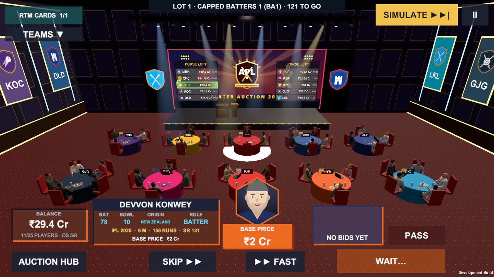

</div>

---

## ✨ Why APL

Most cricket games start at the toss. **APL starts in the auction room**, where seasons are really won and lost.

- 🎙️ **A live 3D auction hall.** An auctioneer calls every lot. There are paddles at the tables, *going once… going twice… SOLD!* calls, and an LED wall with the purse boards.
- 🧠 **AI franchises with personalities.** Each one has needs, moods and target players. Bidding wars break out, steals happen, and no two auctions end the same.
- 📋 **IPL-style rules.** Marquee and capped/uncapped sets, retention slabs, Right to Match, purse, squad and overseas limits, an accelerated round, star premiums and real bid steps: +10 L below 50 L, +25 L up to 2 Cr, +50 L above.
- 👥 **Online multiplayer rooms.** Create a room, share the code, and up to 10 friends pick different franchises. Bots fill the rest.
- 🏆 **Rewards that judge your auction.** A podium, a points breakdown and awards: *Best Squad*, *Steal of the Auction*, *Value King*, *Big Spender* and *Most Balanced*. Lifetime career stats are kept too.
- 🏟️ **Auction → Tournament.** Your exact squad goes into a 10-team league with playoffs. Play your matches in 3D, or simulate them.

---

## 📸 Screenshots

| Auction-first home | Player ceremony | On the block |
|---|---|---|
| 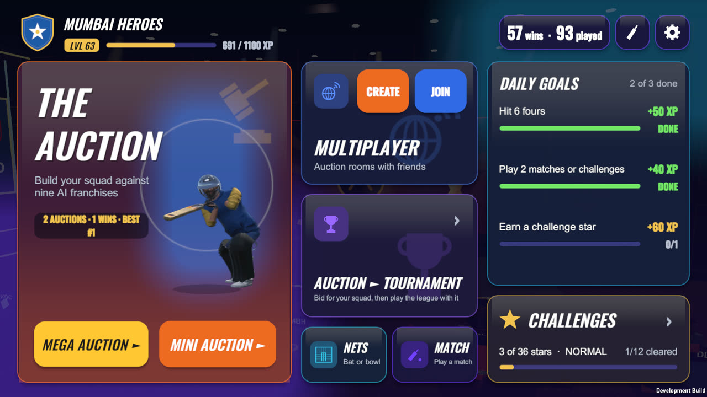 | 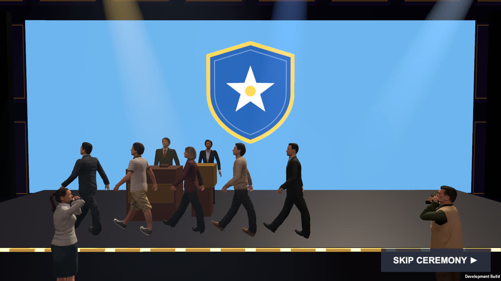 | 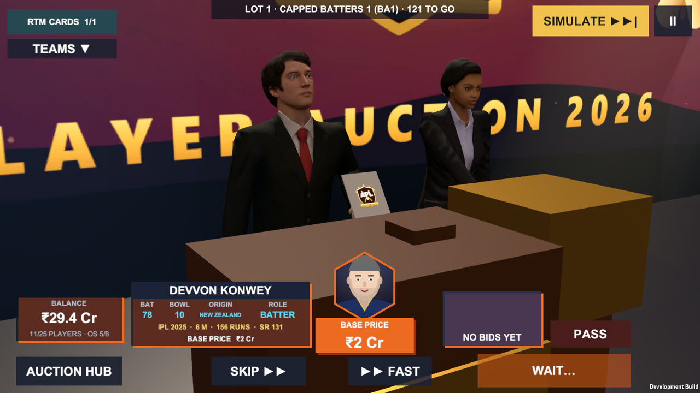 |

| Room lobby & team picker | Host control panel | Bot takes over your paddle |
|---|---|---|
| 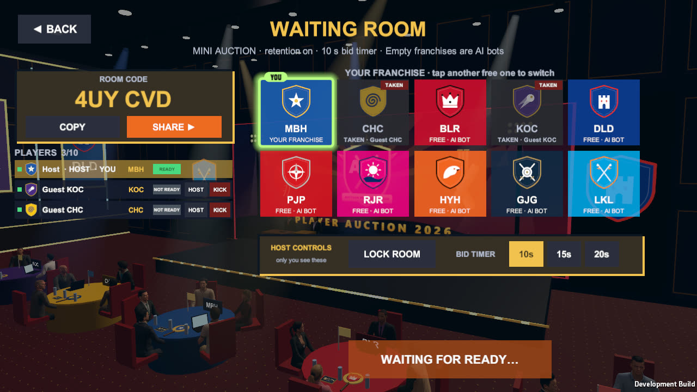 | 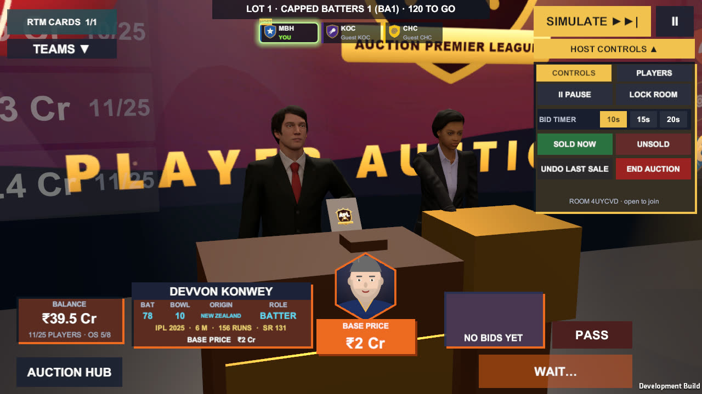 | 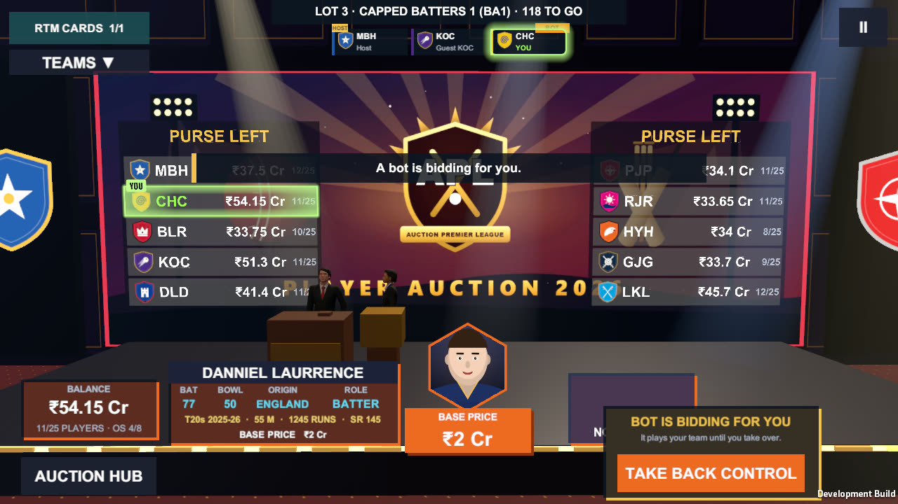 |

| Results podium | Auction awards | Tournament after the auction |
|---|---|---|
| 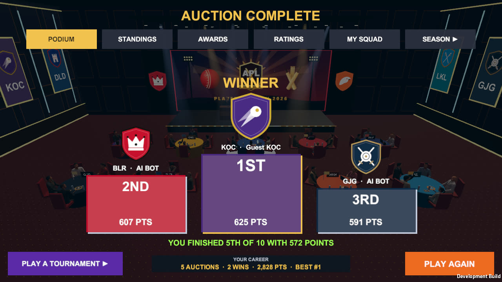 | 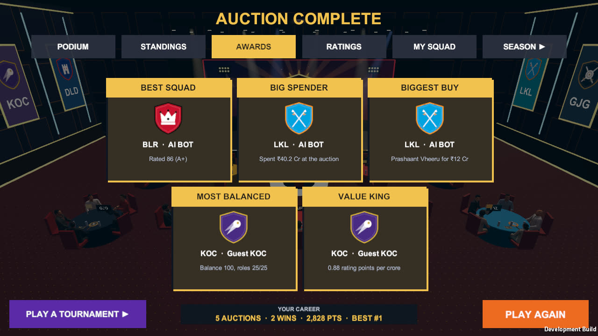 | 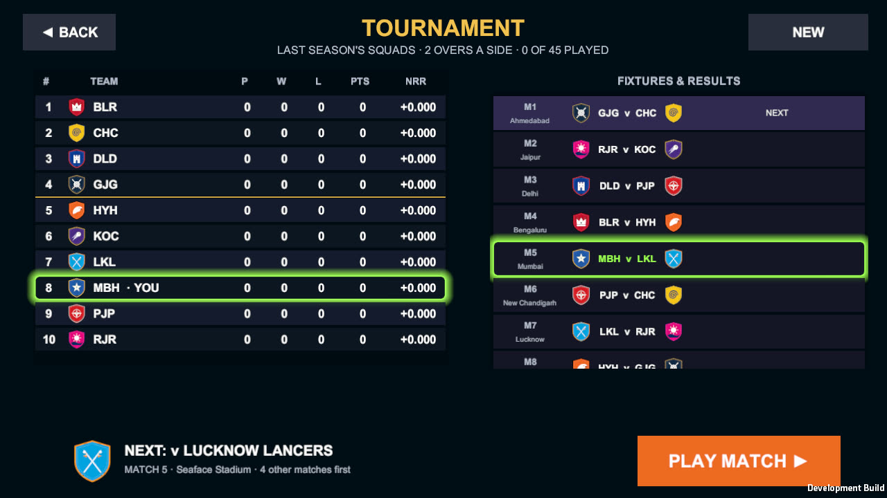 |

<div align="center">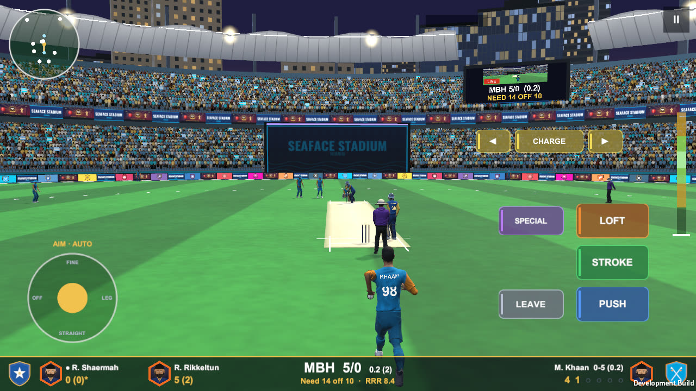<br/><sub>Take your auction squad onto the field.</sub></div>

---

## 🎮 Game modes

| Mode | What you do |
|---|---|
| **Mini auction** | Retain up to 11 players, then fill the gaps against the AI. Fast. |
| **Mega auction** | Rebuild from scratch: retention slabs, RTM, marquee sets and the accelerated round. |
| **Multiplayer room** | A room code for friends. Each human gets a different franchise and empty seats are AI. The host controls the room: pause, timer, kick, lock, sold/unsold, undo and end. A lot closes early only when **everyone** passes. Hit **SIMULATE** and a bot bids for you until you take back control. |
| **Auction → Tournament** | Run the auction, pick your XI, then play or simulate a 10-team league and playoffs with the squads that were actually bought. |
| **Quick match / Nets** | Jump straight into 3D cricket. |

---

## 🧱 Architecture

```
          ┌────────────────────────────┐        WebSocket (wss)       ┌───────────────────────────┐
          │  Unity client (Android)    │ ◀──────── protocol v2 ──────▶ │  Room server (ASP.NET)    │
          │  client-src/Assets         │                                │  server-cs/AplRooms       │
          └────────────┬───────────────┘                                └────────────┬──────────────┘
                       │  same engine source, so solo and online play by identical rules │
                       ▼                                                                ▼
                 ┌─────────────────────────────────────────────────────────────────────────┐
                 │  AuctionCore.Net — pure C# engine (packages/AuctionCore.Net)            │
                 │  rules · AI bidders · market · IPL sets · rooms · awards · season · match sim │
                 └─────────────────────────────────────────────────────────────────────────┘
```

- **One engine everywhere.** The auction rules, AI bidders, room referee, rewards scoring and season simulation are a single pure-C# library. The Unity client and the room server compile the same source, so solo and online results are identical.
- **Server-authoritative rooms.** The server validates every bid, timer, purse, squad and overseas check. It handles reconnects (bot takeover after a grace period) and host hand-over.
- **Data-driven.** The league, teams, formats, rules and the player pool live in `data/` and are versioned. Players use fictionalised "near-real" names.

```
client-src/                 Unity project source (code, UI, hall, match, menus); client/ is generated
packages/AuctionCore.Net/   C# engine + 170+ tests (dotnet test)
server-cs/AplRooms/         multiplayer room server (WebSockets, /health, /ws)
server-cs/RoomBots/         headless end-to-end room harness (10 scenarios, PASS/FAIL)
infra/rooms-cs/             provision + deploy scripts for the room server (Lightsail + Caddy TLS)
data/                       league, rules and the player dataset (apl_dataset.json, versioned)
docs/                       protocol, rating loop, ratings and design notes
tools/                      build pipeline, data builder, voice/commentary generation, compile check
packages/auction_core/      legacy Dart engine (superseded by AuctionCore.Net; golden-file source, kept for reference)
```

> Large art, motion and audio sources (`client-assets/`) aren't in this repository. They are backed up separately.

---

## 🚀 Getting started

**Requirements:** Unity 6.3 LTS (6000.3.x) with Android Build Support, and the .NET 10 SDK.

```powershell
# compile-check the client without opening the editor
dotnet build tools\unity-check\UnityCheck.csproj

# engine tests
dotnet test packages\AuctionCore.Net\tests\AuctionCore.Tests

# create/sync the Unity project, build, and run a scripted play-through with screenshots
.\tools\unity_bootstrap.ps1 -SkipCapture -PlayTest

# Android APK -> build/unity/APL.apk
.\tools\unity_bootstrap.ps1 -SkipCapture -Apk
```

### Multiplayer server

```powershell
dotnet run --project server-cs\AplRooms            # local: http://localhost:8787  (ws://localhost:8787/ws)
dotnet run --project server-cs\RoomBots            # 10 end-to-end room scenarios against an in-process server
.\infra\rooms-cs\deploy.ps1                        # publish + restart the hosted server (see infra/rooms-cs/README.md)
```

You can point the client at any server with `-aplroomserver <url>`, or with the SERVER field (behind "SERVER ▸") on the online page.

### Useful test flags (Windows player)

| Flag | What it does |
|---|---|
| `-aplshots <dir>` | Scripted play-through with screenshots |
| `-aplformat mega` | Run a mega auction |
| `-aplsimulate -apltourneyafter` | Simulate the auction, then the tournament on the auction squads |
| `-aplroomtest <url> host\|join:auto <TEAM>` | Multi-window online room test |
| `-aplaspect 20:9` | Force a phone-shaped (20:9) layout |
| `-apltourneyshots <dir>` | Capture the tournament flow |

---

## 📈 Quality loop

The auction is rated in rounds by an independent reviewer across 11 categories: flow, rules and realism, AI, UI, presentation, room lobby, room auction, results, tournament, home screen and robustness. Fixes are prioritised from each report until the game reaches **8.5/10**. The process is in [`docs/AUCTION_RATER.md`](docs/AUCTION_RATER.md), and the reports are in `build/review/ratings/` (local).

---

## 📄 License

Copyright (c) 2026 Yashu Agrawal. **All rights reserved.**

This source code is published for viewing and evaluation only. No permission is granted to use, copy, modify, merge, publish, distribute, sublicense, sell or create derivative works from it, in whole or in part, without prior written permission. It is provided without warranty of any kind. See [`LICENSE`](LICENSE).

---

<div align="center">

**Source-available for viewing only — All rights reserved.**
Player names are fictionalised; APL isn't affiliated with any real league, franchise or player.

</div>
